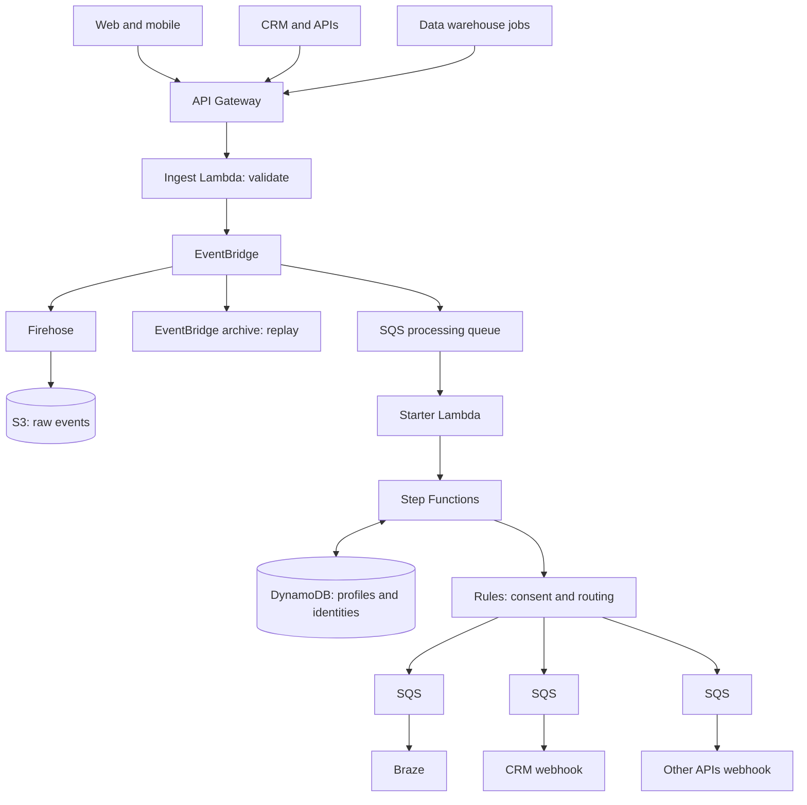

# Customer Data Platform on AWS

An event-driven customer data pipeline in the style of Segment, Hightouch or RudderStack, built from managed AWS services and deployed with Terraform.

Failures in Braze, a CRM or any other destination never stop events from being received. Each destination has its own queue, retries and dead-letter queue.



## Deploy

Requires Terraform 1.6+, the AWS CLI and AWS credentials. Deploying creates billable resources.

```sh
cd infra
terraform init
terraform plan
terraform apply
```

No destination receives data until you enable it. Add its credentials, then list it in `enabled_destinations`:

```sh
aws secretsmanager put-secret-value --secret-id cdp/braze \
  --secret-string '{"rest_endpoint":"https://rest.iad-01.braze.com","api_key":"..."}'
aws secretsmanager put-secret-value --secret-id cdp/crm \
  --secret-string '{"url":"https://example.com/hook","token":"..."}'

terraform apply -var='enabled_destinations=["braze","crm"]'
```

## Send events

```sh
API_KEY=$(aws apigateway get-api-key --include-value --api-key "$(terraform output -raw api_key_id)" --query value --output text)

curl -X POST "$(terraform output -raw events_url)" -H "x-api-key: $API_KEY" -d '{
  "type": "consent", "user_id": "u1", "consent": {"marketing": true}
}'

curl -X POST "$(terraform output -raw events_url)" -H "x-api-key: $API_KEY" -d '{
  "type": "track", "event": "Signed Up", "user_id": "u1", "traits": {"plan": "pro"}
}'
```

Events need a `type` (`track`, `identify`, `page`, `screen` or `consent`) and at least one of `user_id`, `anonymous_id` or `email`. Send up to 100 at once as `{"batch": [...]}`. Set your own `event_id` to make retries safe.

## How it behaves

- **Consent:** delivery is blocked without consent. Braze requires `marketing`, the CRM requires `crm`, and other APIs require `analytics`. Change this in `src/cdp/rules.py`.
- **Identity:** identifiers seen together link to one customer. Emails are stored in keys as SHA-256 hashes, although any email sent inside `traits` is stored as sent.
- **Duplicates:** an `event_id` is processed once for as long as Step Functions remembers the execution name (90 days).
- **Failures:** messages retry 5 times, then move to a dead-letter queue and raise an alarm.

## Known limitations

- Conflicting identities are logged and not merged. Merging needs a business rule.
- Replaying an event from the archive or S3 is a no-op while its execution name is remembered, so a replay within 90 days needs new `event_id` values.
- CRM and other API destinations are generic webhooks. Salesforce OAuth and field mapping are not included.
- The data warehouse path is a push to the batch API. Scheduled warehouse extraction is not included.
- The API key is suitable for servers. Browser use needs CORS and a public write-key approach.
- There is no deletion workflow for privacy requests, such as GDPR or CCPA erasure.
- CloudTrail is an account-level service and is not created here.
- Terraform state is local. Use a remote backend for team or production use.

## Test

```sh
python -m unittest discover -s tests
```
