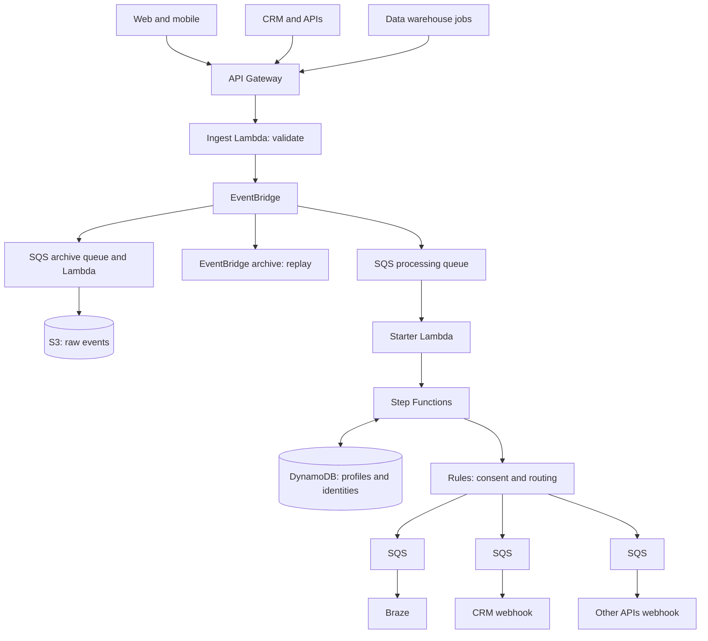
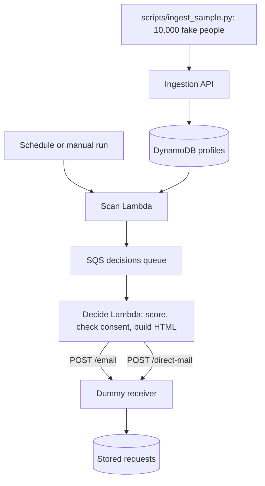
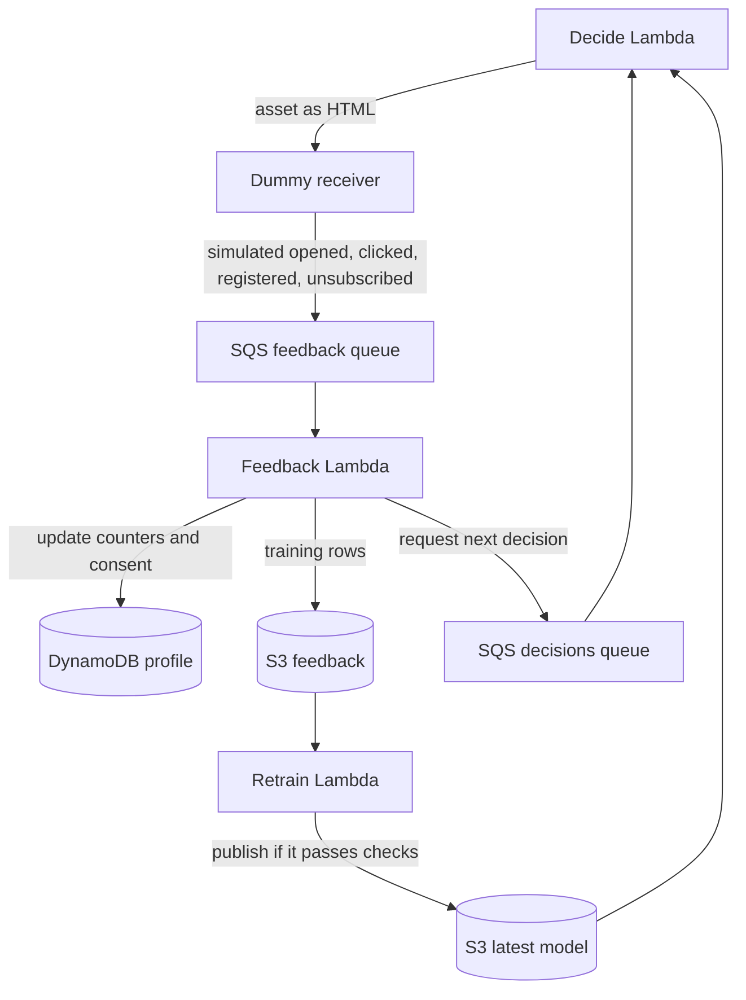

# Customer Data Platform on AWS

An event-driven customer data pipeline in the style of Segment, Hightouch or RudderStack, built from managed AWS services and deployed with Terraform.

Failures in Braze, a CRM or any other destination never stop events from being received. Each destination has its own queue, retries and dead-letter queue.

It also includes a next best action demo for Eric Health, a fictional company: 10,000 made-up people, propensity models, 1,000 message variations with approval statuses, a dummy email and direct mail service, a feedback loop and a web app. See [docs/ARCHITECTURE.md](docs/ARCHITECTURE.md) for the full design, and [docs/PRODUCTION_REQUIREMENTS.md](docs/PRODUCTION_REQUIREMENTS.md) for what it would take to run this in production, including the AWS accounts and services to provision.

## Quick start

You need an AWS account, the AWS CLI, Terraform 1.6+ and Python 3.12. This creates billable resources, so set an AWS budget first. Running the full demo cost us a small amount, but check your own bill.

```sh
git clone https://github.com/DeductiveReasons/customer-data-platform.git
cd customer-data-platform
python -m unittest discover -s tests

# Sign in, then deploy. If Terraform cannot read your AWS login session, export it first:
# eval "$(aws configure export-credentials --profile <profile> --format env)"
aws login --profile <profile>
cd infra
terraform init
terraform plan -var="region=us-east-2" -out=deploy.tfplan
terraform apply deploy.tfplan

# Open the web app and get its password.
terraform output webapp_url
aws secretsmanager get-secret-value --secret-id "$(terraform output -raw webapp_secret)" --query SecretString --output text

# Load the 10,000 made-up people, then follow "Next best action demo" below.
API_KEY=$(aws apigateway get-api-key --include-value --api-key "$(terraform output -raw api_key_id)" --query value --output text)
python ../scripts/ingest_sample.py "$(terraform output -raw events_url)" "$API_KEY"
```

Images are not stored in Git. Until you generate them, messages use built-in illustrations. Generating all 100 uses Stable Image Core on Amazon Bedrock in `us-west-2`, which is charged per image and may need a Marketplace agreement:

```sh
pip install boto3
python ../scripts/generate_ai_images.py "$(terraform output -raw raw_bucket)" ./ai-images
```

To restart everyone's journey and archive earlier results, run `python ../scripts/reset_campaign.py "$(terraform output -raw profiles_table)" "$(terraform output -raw raw_bucket)" <run-name>`.

To remove everything, set `deletion_protection=false` and apply, empty the S3 bucket, then run `terraform destroy`.



## Daily runs and the full-year simulation

The model runs once a day. Each run updates the content bandit, saves results and a 14-day send forecast, adds about 200 new leads, delivers direct mail that is due after its 7-day lead time, and decides for everyone who is due. Set `daily_run_enabled=false` to stop the schedule.

`scripts/simulate_year.py` runs 365 days in one process with the same decision, bandit and outcome code, then loads the results into AWS. That takes under an hour, where the live pipeline would take many hours. Its messages do not pass through the queues and dummy endpoints.

## Deploy

Requires Terraform 1.6+, the AWS CLI and AWS credentials. Deploying creates billable resources.

```sh
cd infra
terraform init
terraform plan
terraform apply
```

No destination receives data until you enable it. Add its credentials, then list it in `enabled_destinations`:

```sh
aws secretsmanager put-secret-value --secret-id cdp/braze \
  --secret-string '{"rest_endpoint":"https://rest.iad-01.braze.com","api_key":"..."}'
aws secretsmanager put-secret-value --secret-id cdp/crm \
  --secret-string '{"url":"https://example.com/hook","token":"..."}'

terraform apply -var='enabled_destinations=["braze","crm"]'
```

## Send events

```sh
API_KEY=$(aws apigateway get-api-key --include-value --api-key "$(terraform output -raw api_key_id)" --query value --output text)

curl -X POST "$(terraform output -raw events_url)" -H "x-api-key: $API_KEY" -d '{
  "type": "consent", "user_id": "u1", "consent": {"marketing": true}
}'

curl -X POST "$(terraform output -raw events_url)" -H "x-api-key: $API_KEY" -d '{
  "type": "track", "event": "Signed Up", "user_id": "u1", "traits": {"plan": "pro"}
}'
```

Events need a `type` (`track`, `identify`, `page`, `screen` or `consent`) and at least one of `user_id`, `anonymous_id` or `email`. Send up to 100 at once as `{"batch": [...]}`. Set your own `event_id` to make retries safe.

## How it behaves

- **Consent:** delivery is blocked without consent. Braze requires `marketing`, the CRM requires `crm`, and other APIs require `analytics`. Change this in `src/cdp/rules.py`.
- **Identity:** identifiers seen together link to one customer. Emails are stored in keys as SHA-256 hashes, although any email sent inside `traits` is stored as sent.
- **Duplicates:** an `event_id` is processed once for as long as Step Functions remembers the execution name (90 days).
- **Failures:** messages retry 5 times, then move to a dead-letter queue and raise an alarm.

## Known limitations

- Conflicting identities are logged and not merged. Merging needs a business rule.
- Replaying an event from the archive or S3 is a no-op while its execution name is remembered, so a replay within 90 days needs new `event_id` values.
- CRM and other API destinations are generic webhooks. Salesforce OAuth and field mapping are not included.
- The data warehouse path is a push to the batch API. Scheduled warehouse extraction is not included.
- The API key is suitable for servers. Browser use needs CORS and a public write-key approach.
- There is no deletion workflow for privacy requests, such as GDPR or CCPA erasure.
- CloudTrail is an account-level service and is not created here.
- Terraform state is local. Use a remote backend for team or production use.

## Next best action demo

This adds a synthetic population, a propensity model and a decision pipeline that calls a dummy email and direct mail service. **No real email or mail is ever sent.** The receiver only validates and stores requests for 7 days.



Run it after deploying:

```sh
cd infra
API_KEY=$(aws apigateway get-api-key --include-value --api-key "$(terraform output -raw api_key_id)" --query value --output text)
python ../scripts/ingest_sample.py "$(terraform output -raw events_url)" "$API_KEY"

# Wait for the events to finish processing, then run a scan.
aws lambda invoke --function-name "$(terraform output -raw nba_scan_function)" /dev/stdout

# See what the dummy service received.
aws dynamodb scan --table-name "$(terraform output -raw receiver_table)" --select COUNT
```

Set `nba_schedule_enabled=true` to scan daily. To retrain or preview without AWS:

```sh
python scripts/train_model.py
python scripts/simulate_local.py
```

**How decisions work:** one logistic regression per asset estimates the chance of registering, given the customer's traits, their engagement so far and the channel. The pipeline picks the asset and channel with the highest `propensity x registration value - channel cost`, and stops if none is positive. Contact needs `marketing` consent and consent for that channel. Each customer gets at most 4 sign-up messages, never the same asset twice in a row, and 10% of decisions explore other assets so the model keeps learning.

### Eric Health asset library

Eric Health is a fictional company used for this demo. `src/cdp/asset_library.json` holds the campaign aimed at fitness program registrations: a program introduction, a member story, a free trial, a coach session and an onboarding welcome. Each renders as HTML for email or direct mail, combined with one of 100 images in `src/cdp/content.py`. That makes 1,000 variations, all auto-approved for now, and any of them can be set to pending approval in the web app. Run `python scripts/preview_assets.py` to create a local gallery.

### Feedback loop



Feedback affects decisions in two ways. It changes the customer's next decision straight away, because their opens and clicks are model features. It also trains new models when the retrain Lambda runs, which only publishes assets with at least 500 rows, 20 registrations and a holdout AUC of 0.55. Registered customers get one onboarding message and then leave the sign-up journey. An unsubscribe removes consent for that channel.

Run a retrain after a campaign, allowing a few minutes for the archive Lambda to write the data:

```sh
aws lambda invoke --function-name "$(terraform output -raw nba_retrain_function)" /dev/stdout
```

### Query and dashboard

Query these tables in Amazon Athena, using the workgroup and database from `terraform output`. Saved queries are under the **Saved queries** tab.

| Table | Contents |
|---|---|
| `people` | One row per person, with status and current next best action |
| `nba_history` | Every message sent, with the asset, channel and score |
| `email_engagement` | Simulated email opens, clicks, registrations and unsubscribes |
| `direct_mail_engagement` | Simulated direct mail QR visits, registrations and unsubscribes |

Refresh `people` and the dashboard's people totals by running the export function. Its schedule is off unless `nba_schedule_enabled=true`.

```sh
aws lambda invoke --function-name "$(terraform output -raw nba_export_function)" /dev/stdout
terraform output dashboard_url
```

The archive can store a row twice after a retry, so count `DISTINCT message_id`. Athena charges by data scanned, and this workgroup stops any query that scans more than 1 GB.

Limitations:

- The people, behavior, model accuracy, registration value and channel costs are all invented. The results show that the pipeline works, not how a real campaign would perform.
- The dummy receiver sends feedback through SQS. A real provider would call a signed webhook, and its events would arrive over hours or days.
- Direct mail reads cannot be observed, so mail only reports QR code visits.
- Scores are not causal uplift estimates, because a person who registers might have done so without the message. Measuring lift needs a holdout group that receives nothing.
- Exploration rows are not reweighted during training, and there is no drift monitoring or automated rollback.
- A person whose send is recorded but whose feedback never arrives stays paused until the next scan.
- A real sender would also need suppression lists, working unsubscribe links, address validation and legal review, especially for any health-related claims.

## Test

```sh
python -m unittest discover -s tests
```
