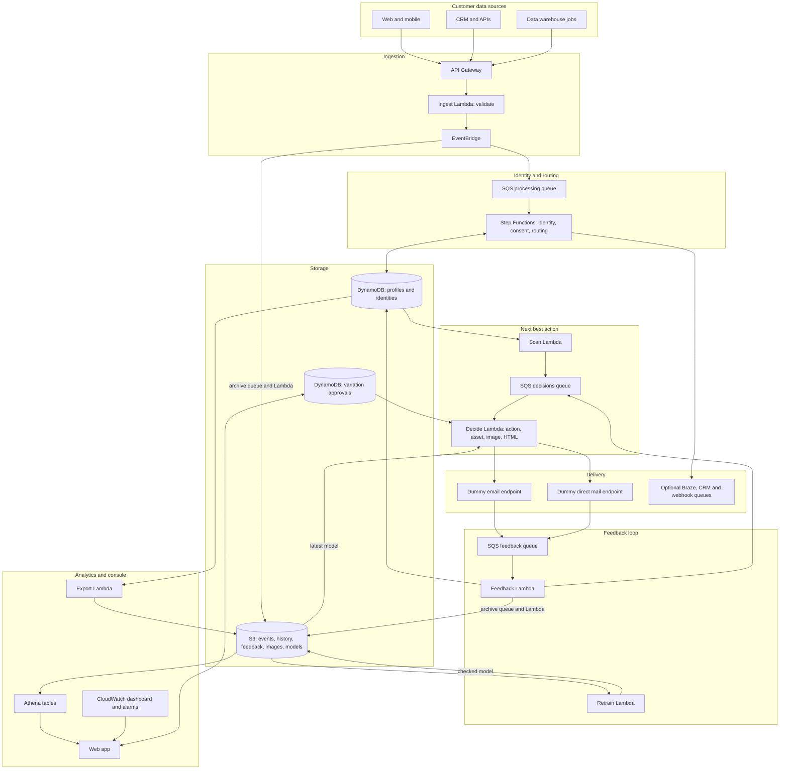

# Architecture

This platform receives customer events, builds profiles, decides each person's next best action and content, sends a request to a dummy email or direct mail service, and learns from simulated engagement.

Everything runs on managed AWS services and is defined in Terraform.

## How a message is decided

1. A scan, or feedback from the previous message, queues a person for a decision.
2. Consent is checked. Contact needs `marketing` consent plus consent for that channel.
3. One logistic regression per asset scores the chance of registering. The channel is a model feature (`is_direct_mail`), so email and direct mail score separately.
4. The highest `propensity x registration value - channel cost` wins. If nothing is positive or allowed, the next best action is `no_contact`.
5. A second model picks the image theme most likely to get a click, then an image in that theme. It does not use age.
6. Variations pending approval are skipped, and the next best approved option is used.
7. The HTML is built and sent to `/email` or `/direct-mail`.
8. Simulated opens, clicks, registrations and unsubscribes update the profile and trigger the next decision.

A person gets up to 4 sign-up messages. Someone who registers gets one onboarding message and then stops. 10% of decisions explore other options so the models keep learning.

## Next best action fields

| Field | Meaning |
|---|---|
| `next_best_action` | `email`, `direct_mail` or `no_contact` |
| `next_best_action_time` | Suggested UTC send time, from the contact gap and a rule for the person's best local hour |
| `no_contact_reason` | Why there is no contact, such as `no_marketing_consent` or `journey_complete` |
| `next_best_asset` | The chosen campaign asset |
| `next_best_image` | The chosen library image |

The time is a starting rule, not a learned model, and the demo pipeline does not yet wait for it before sending.

## Digital assets and approvals

A variation is one asset, one channel and one image. Five assets, two channels and 100 images make 1,000 variations.

Every variation is auto-approved for now. The Digital assets page can set one to pending approval, and a pending variation is not sent. The approvals table only stores variations a person has changed, so no record means auto-approved.

## Web app

| Page | Shows |
|---|---|
| Overview | Totals, registration rates, next best actions and the endpoint library |
| Performance | Funnels by asset and channel |
| Digital assets | Every variation, with previews and approval status |
| Campaigns | The five campaign assets and their results |
| Image library | All 100 images and their results |
| People | Search, then each person's profile, scores and previous messages |
| Monitoring | Queues, failed messages, function errors and alarms |
| Usage and costs | Services, costs, records, API calls and storage |

## Design decisions

- **Failures stay separate:** queues sit between every step, and each has a dead-letter queue and alarm.
- **Duplicates are safe:** event IDs and message records stop a retry from processing or sending twice.
- **Consent fails closed:** missing consent means no contact.
- **No credentials in code:** secrets live in AWS Secrets Manager. The dummy receiver token and web app password are also in Terraform state, which must stay private.
- **No Firehose:** archive files are written by an SQS queue and Lambda, so the system also works on accounts that block Amazon Data Firehose.
