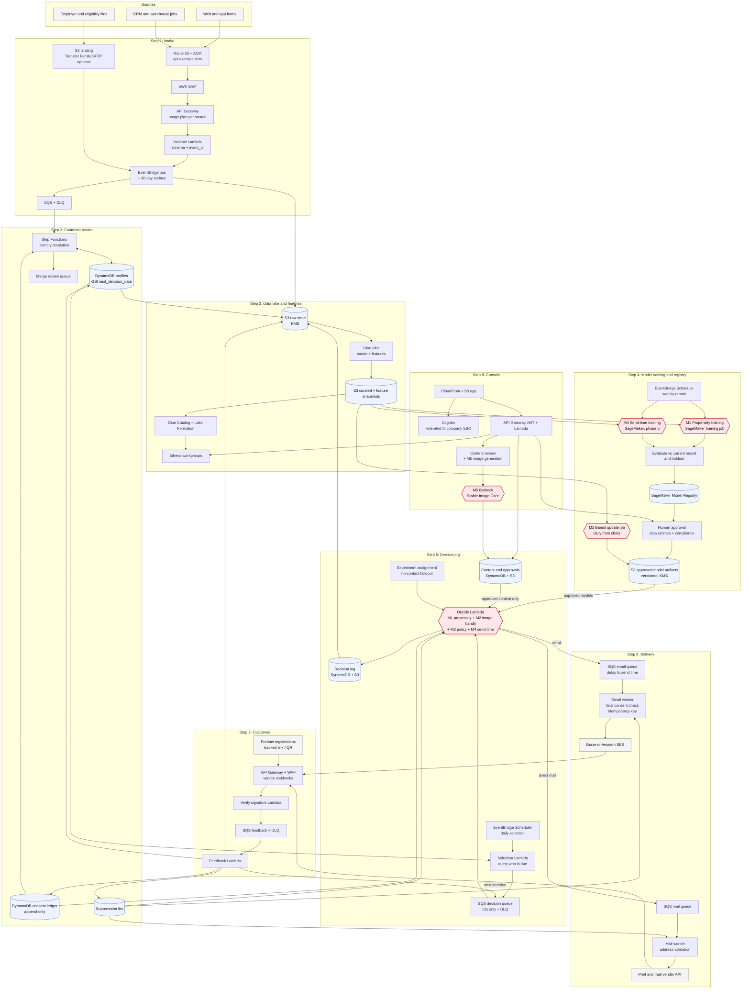
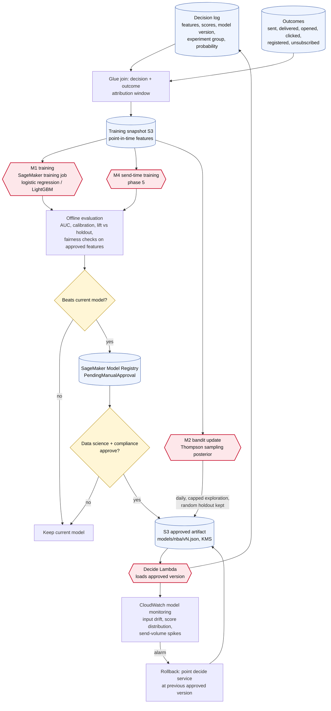
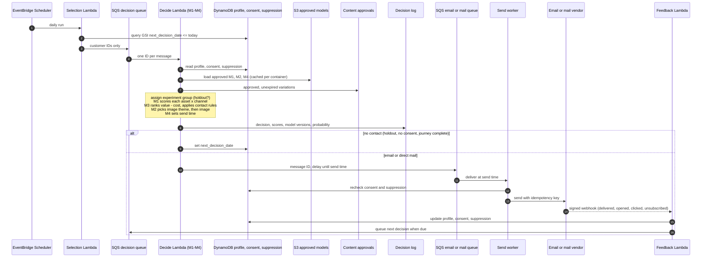
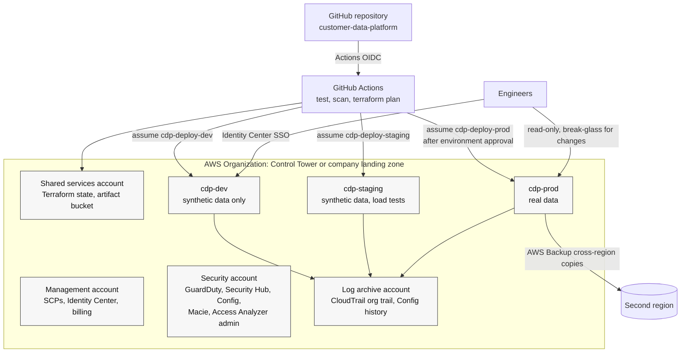

# Production Architecture

November 6, 2026

This is the target production design for the customer data platform: every service, every model, and how data moves between them. It builds on the prototype in this repository ([architecture](ARCHITECTURE.md)) and the [production requirements](PRODUCTION_REQUIREMENTS.md). The access and accounts IT must provision for it are in [IT access request](IT_ACCESS_REQUEST.md).

Models are drawn as hexagons in every diagram, so you can follow where each one is trained, approved, served and monitored.

## The models

| # | Model | What it decides | Prototype | Production |
|---|---|---|---|---|
| M1 | Registration propensity | Chance a person registers if sent a given asset on a given channel (email or direct mail is a feature) | One logistic regression per asset, `src/cdp/nba_model.json`, retrain job `nba_retrain.py` | SageMaker training job (logistic regression first; LightGBM only if it beats it on real outcomes), versioned in SageMaker Model Registry, human approval before publish |
| M2 | Image theme selector | Which image theme is most likely to get a click | Contextual bandit, linear Thompson sampling, one arm per theme, 10% random holdout (`src/cdp/bandit.py`, `content.py`) | Same algorithm, updated daily from real click outcomes by a bandit update job, with an exploration cap and a manual off switch |
| M3 | Decision policy | Ranks options: `propensity x registration value - channel cost`, then contact rules, consent, approvals and experiment group | Code in `nba_decide.py`, `rules.py` | Same, with business values from finance in a versioned config, and every decision logged with model versions and scores |
| M4 | Send time | Best day and hour to send | Fixed rule (not learned) | Phase 5: learned model trained in SageMaker; until then the rule, enforced by the send queue |
| M5 | Image generation (offline) | Creates library images for new themes | Bedrock Stable Image Core in `us-west-2` (`scripts/generate_ai_images.py`) | Same Bedrock model, run on request; every image goes through content review before it can be sent |

M1, M2 and M4 run inside the decide service as small in-process models (JSON weights loaded from the approved model artifact in S3). If a future model is too large for Lambda, it moves to a SageMaker Serverless Inference endpoint without changing the rest of the flow.

## 1. End-to-end flow

How to read it:

1. **Intake** accepts events through a custom-domain API behind WAF, or bulk files through S3. Every event lands on the EventBridge bus and is archived to the raw zone.
2. **Customer record** resolves identity in Step Functions, keeps one profile per person, and holds consent and suppression separately. No consent record means no contact.
3. **Data lake** curates raw data and writes feature snapshots that both training and analytics use, so training sees exactly what was known at decision time.
4. **Training** retrains M1 (and later M4) on a schedule, compares each new model to the current one and to the holdout, registers it, and publishes only after a person approves. M2 updates daily from clicks.
5. **Decisioning** picks who is due each day, loads only approved models and approved content, and logs every decision with model versions, scores and experiment group.
6. **Delivery** uses one queue per channel. Workers recheck consent and suppression right before sending and pass an idempotency key so a retry never sends twice.
7. **Outcomes** come back as signed vendor webhooks and product registrations, update the profile and consent, feed the lake, and queue the next decision.
8. **Console** is behind company SSO. It shows results, approves content and models, and can generate new images with Bedrock, which then wait for review.

## 2. Model lifecycle

Rules that apply to every model:

- Features are reviewed by legal and data science before use. Age and employer attributes stay out until approved.
- A model is published only if it beats the current one on a holdout and a person approves it in the Model Registry.
- Every decision records the model version, so any result can be traced and any version rolled back.
- The no-contact holdout and the bandit's random holdout are never turned off, so lift is always measured against a fair comparison.

## 3. One decision, step by step

## 4. Accounts and deployment

- Infrastructure stays in Terraform. State moves from the prototype's local file to an encrypted S3 bucket with locking in the shared services account, one state per environment.
- Engineers sign in through IAM Identity Center. Production changes go only through the CI deploy role after an approval in the GitHub `prod` environment.
- No VPC is needed for the serverless core. Add one, with VPC endpoints, only if the warehouse or CRM must be reached privately or company policy requires egress control.

## 5. Services by component

| Component | AWS services | Notes |
|---|---|---|
| Edge | Route 53, ACM, CloudFront, AWS WAF | Custom domains for the API and console; ACM certificates for CloudFront must be in `us-east-1` |
| Intake | API Gateway (REST), Lambda, EventBridge, SQS, S3, Transfer Family (optional) | Usage plan and key per source system; event_id de-duplication |
| Customer record | Step Functions, DynamoDB | Profiles with a GSI on next decision date; append-only consent ledger; suppression list; point-in-time recovery |
| Data lake | S3 (raw, curated, restricted), Glue jobs and Data Catalog, Lake Formation, Athena | Query limits per workgroup; restricted zone for contact details |
| Models | SageMaker (training jobs, Model Registry, optional Serverless Inference), ECR (training images), Bedrock (Stable Image Core, `us-west-2`) | Weekly M1 retrain, daily M2 update, human approval in the registry |
| Decisioning | EventBridge Scheduler, Lambda, SQS, DynamoDB | IDs only in queues; reserved concurrency on the decide function |
| Delivery | SQS, Lambda, Amazon SES (if not Braze), Secrets Manager for vendor keys | Delay queues enforce send time; idempotency keys on every send |
| Outcomes | API Gateway, WAF, Lambda, SQS | Vendor webhook signatures verified before anything is stored |
| Console | CloudFront, S3, Cognito (federated SSO), API Gateway JWT authorizer, Lambda | Roles mask personal data; every profile view is logged |
| Security | KMS customer-managed keys, Secrets Manager rotation, CloudTrail, GuardDuty, Security Hub, Config, Macie, IAM Access Analyzer | Separate KMS key per data class |
| Operations | CloudWatch (logs, metrics, alarms, dashboards), X-Ray, SNS to the on-call tool, AWS Budgets, Cost Explorer | Alarm on every DLQ, failed run, consent-check failure and send-volume spike |
| Recovery | AWS Backup | Cross-region copies of DynamoDB and critical S3 data; RPO 1 hour, RTO 4 hours |
| Delivery pipeline | GitHub Actions, IAM OIDC provider, S3 state bucket with locking | Plan on every pull request, apply with approval |

## 6. Data protection

| Data | Where it lives | Protection |
|---|---|---|
| Contact details (name, email, address) | DynamoDB profiles, S3 restricted zone | KMS key for personal data; never in queue messages, logs or partition keys; masked in the console by role |
| Consent and suppression | DynamoDB ledger, S3 | Append-only, dated, with source and legal text version |
| Decisions and outcomes | DynamoDB, S3 curated | Customer ID only; used for training and reporting |
| Model artifacts | S3 approved artifacts, SageMaker Model Registry | Versioned; publish requires approval; rollback by version |
| Vendor credentials | Secrets Manager | Rotated; read only by the send workers |
| Images and content | S3, approvals table | AI-generated images reviewed before approval |

## 7. Moving from the prototype

| Prototype | Production change |
|---|---|
| Local Terraform state with secrets | Remote encrypted state, OIDC deploys, secrets created outside state where possible |
| Full table scan to find who is due | GSI query on next decision date |
| Queues carry traits and contact details | Queues carry IDs only |
| Shared console password | Cognito with company SSO and roles |
| Simulated outcomes | Signed vendor webhooks and real registrations |
| No approval record means approved | No approval record means not sendable |
| Model retrained in Lambda without a gate | SageMaker training, evaluation, registry and human approval |
| Bandit optimizes clicks | Confirm with real data that clicks predict registrations |
| AWS-managed encryption keys | Customer-managed KMS keys per data class |
| One account, no guardrails | Dev, staging and prod accounts under the company organization |

AWS service details here come from general knowledge and were not checked against current AWS pages. Confirm them with your AWS account team.
