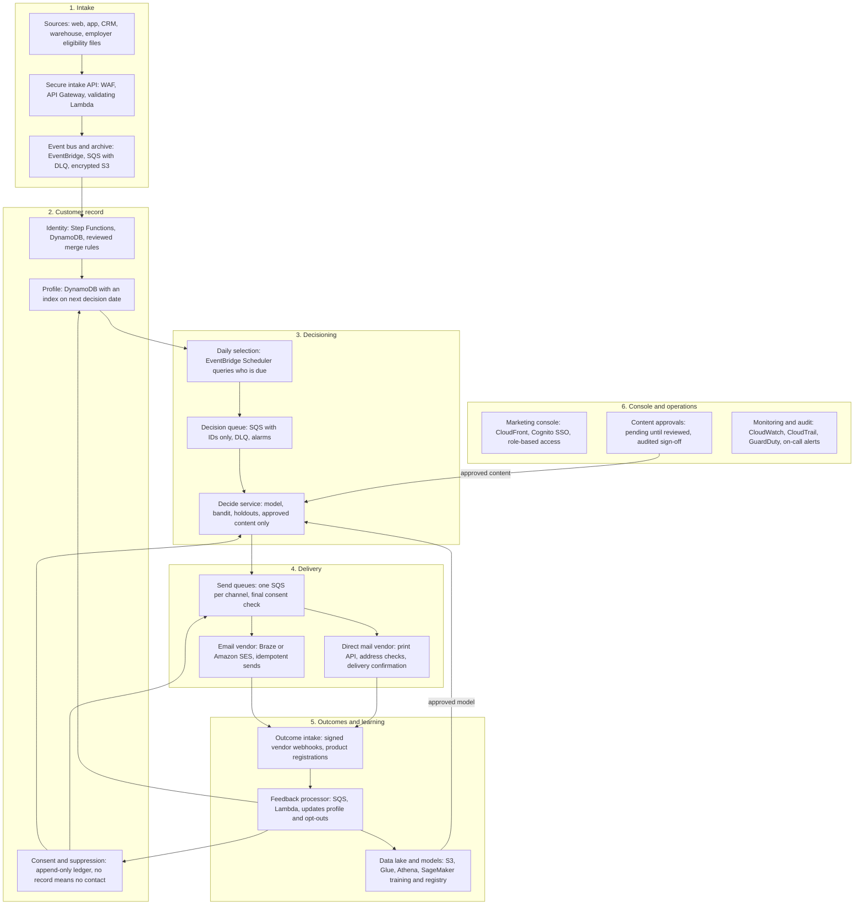

# Customer Data Platform Production Requirements

November 1, 2026

Build a production system that decides each lead's next best email or direct mail, sends it through real vendors, and learns from real registrations. This repository proves the design works end to end, but only on simulated people, so it is a reference and not production code.

A live, editable copy of this document is kept outside the repository. This copy is a snapshot.

## Scope

First release covers one campaign, two channels and real registrations. It must send only to people with recorded consent, and only content that has passed review.

**In scope:** lead intake, identity, consent, next best action, image selection, email and direct mail delivery, outcome tracking, experiments and a marketing console.

**Out of scope for first release:** SMS, push, real-time triggers, automated send-time learning and fully automated model publishing.

**What the prototype proved:** the pipeline runs daily, a 365-day simulation completed, direct mail timing holds at 7 days, and a contextual bandit can be measured against a random holdout.

**What it did not prove:** real customer response. The simulator's behavior was written by hand, so the 33% bandit click lift and all other test results must not be used as business forecasts. LightGBM also tied logistic regression (AUC 0.771 vs 0.774), so production should keep whichever is simpler until real data shows a gain.

## Target architecture

Keep the prototype's serverless, queue-based design, and replace its simulated parts with real vendors and real outcomes. Serverless fits a daily batch workload, and each failure stays in its own queue.

Outcomes loop back to update profiles and consent, and approved models and content feed the decide service. Customer details stay out of queues: messages carry IDs, and each service reads what it needs from the encrypted store.

**Environments:** separate dev, staging and production accounts, with synthetic data only outside production.

**Region:** one primary region, `us-east-2` unless the team has a standard. Backups are copied to a second region, and Bedrock image generation can stay in `us-west-2`.

## AWS provisioning

Request three workload accounts, a signed AWS Business Associate Addendum if legal confirms health data is involved, and the services below. Don't reuse the prototype account, which has simulated data, local Terraform state and an org policy that blocks Firehose.

### Accounts and agreements

| Item | What to request | Why |
| --- | --- | --- |
| AWS Organization | Control Tower landing zone, or placement in the company's existing one | Central guardrails and account creation |
| Workload accounts | `cdp-dev`, `cdp-staging`, `cdp-prod` | Keeps real customer data out of test environments |
| Shared accounts | Log archive, security tooling and shared CI/CD, if not already present | Audit logs stay out of reach of workload admins |
| Business Associate Addendum | Accept through AWS Artifact for the organization, if legal confirms it applies | Required before storing protected health information on AWS |
| Support plan | Business Support or higher on `cdp-prod` | Production incident response |
| Service control policies | Allow every service listed here, restrict regions, and block disabling logging | The prototype showed that org policies can block a needed service |
| Access | IAM Identity Center tied to company SSO, with no long-lived IAM users | Named, auditable access |
| Budgets | AWS Budgets alerts per account, sent to a team address | Catches runaway costs early |

### Services by account

These go in dev, staging and production unless noted.

| Layer | AWS services | Provisioning notes |
| --- | --- | --- |
| Intake | API Gateway, AWS WAF, Lambda, EventBridge | Custom domain, usage plans per source system |
| Bulk files | S3, AWS Transfer Family (only if partners require SFTP) | For employer and eligibility files |
| Customer record | DynamoDB, Step Functions | On-demand capacity, point-in-time recovery, deletion protection, customer-managed KMS key |
| Decisioning | EventBridge Scheduler, SQS, Lambda | One queue and dead-letter queue per step, reserved concurrency |
| Delivery | SQS, Lambda, optionally Amazon SES | SES needs a production access request, plus a dedicated IP decision. Not needed if Braze sends |
| Data lake | S3, Glue Data Catalog, Athena, Lake Formation | Separate raw, curated and restricted zones. Query limits per workgroup |
| Machine learning | SageMaker training and Model Registry, ECR | Training runs on a schedule, and a person approves publishing |
| Image generation (optional) | Amazon Bedrock | Model access request and Marketplace agreement. Prototype used Stable Image Core in `us-west-2` |
| Console | CloudFront, S3, Cognito, ACM, Route 53 | Cognito federated to company SSO |
| Secrets and encryption | Secrets Manager, KMS | Separate keys per data class, rotation on |
| Monitoring | CloudWatch, X-Ray, SNS | Alerts routed to the on-call tool |
| Security and audit | CloudTrail organization trail, GuardDuty, Security Hub, AWS Config, Macie, IAM Access Analyzer | Enable through the security account |
| Recovery | AWS Backup | Cross-region copies for DynamoDB and critical S3 data |
| Deployment | Terraform state in S3 with locking, GitHub OIDC role per account | No stored deploy keys. Production applies need approval |

### Network

No VPC is required for the serverless core. Provision one only if the warehouse, CRM or company policy requires private connectivity, then add VPC endpoints, and a Transit Gateway or PrivateLink as needed.

### Quotas to check before launch

Size these from the real lead forecast. For scale only, the simulation produced about 400,000 emails and 75,000 mail pieces in a year, from 100,000 starting leads and about 200 new leads a day.

- Lambda concurrent executions per region
- API Gateway requests per second and bulk upload size
- SES daily sending quota and send rate, if SES is used
- Bedrock image requests per minute, if used
- SageMaker training instance limits for the chosen instance type

## Prototype gaps

The largest risks are the prototype's default approval, shared password and simulated outcomes, and each must change before any real send.

| Area | Prototype | Production |
| --- | --- | --- |
| Content approval | No record means auto-approved | No approval record means not sendable |
| Console access | One shared password, with people's profiles visible | Company SSO, roles and access logs |
| Outcomes | Simulator generates opens, clicks and registrations | Signed vendor webhooks and real registration events |
| Clock | Simulated day counter | Real dates, with time zones and daylight saving handled |
| Consent | Current true or false values on the profile | Dated history with source, plus a global suppression list |
| Daily selection | Full DynamoDB table scan | Index query on next decision date |
| Queues | Messages carry traits, consent and contact details | Messages carry IDs only |
| Duplicate sends | A send timeout releases the claim and retries, which can send twice | Vendor idempotency key on every send |
| Send time | Calculated but not enforced | Enforced by the send queue |
| Model inputs | Includes age and employer attributes | Legal and fairness review of every feature before use |
| Model updates | Bandit updates daily, and the next best action model is not retrained from feedback | Scheduled retraining, checks and human approval |
| Bandit goal | Optimizes clicks | Decide whether clicks are a good stand-in for registrations, using real data |
| Measurement | Holdout for images only | Also a no-contact holdout, to measure registrations caused by messaging |
| Privacy | No erasure workflow | Deletion across profile, data lake and vendors |
| Infrastructure | Local Terraform state containing secrets | Remote encrypted state, with secrets kept out of state where possible |

## Functional requirements

P0 items block go-live, and P1 items follow in the first release after it.

### Intake and identity

| ID | Requirement | Priority |
| --- | --- | --- |
| ING-1 | Accept single and batch events through an authenticated API, and reject invalid events with a clear error. | P0 |
| ING-2 | Process each `event_id` once, including after retries and replays. | P0 |
| ING-3 | Import leads and employer data from agreed files or warehouse jobs, with row-level error reports. | P0 |
| ING-4 | Link identifiers to one customer, and send conflicts to a review queue under written merge rules. | P0 |

### Consent and suppression

| ID | Requirement | Priority |
| --- | --- | --- |
| CON-1 | Store every consent change with purpose, channel, source, time and legal text version. | P0 |
| CON-2 | Treat missing consent as no contact, and recheck immediately before each send. | P0 |
| CON-3 | Apply unsubscribes, bounces, complaints and do-not-mail requests to a global suppression list. | P0 |

### Next best action

| ID | Requirement | Priority |
| --- | --- | --- |
| NBA-1 | Decide daily for each due person: email, direct mail or no contact, with asset, send date and reason. | P0 |
| NBA-2 | Rank options by predicted registration value minus channel cost, using approved business values. | P0 |
| NBA-3 | Enforce configurable contact rules. Prototype values: 4 messages, 3 days after email, 14 days after mail is sent. | P0 |
| NBA-4 | Log model version, inputs, scores and reason for every decision, including no contact. | P0 |
| NBA-5 | Learn the best send time, replacing the prototype's fixed rule. | P1 |

### Experiments and bandit

| ID | Requirement | Priority |
| --- | --- | --- |
| EXP-1 | Keep a persistent no-contact holdout and report registrations caused by messaging. | P0 |
| EXP-2 | Assign experiment groups randomly, and log the probability of each assignment. | P0 |
| EXP-3 | Set the winner metric, sample size and test length before a test starts, and correct for many segment comparisons. | P0 |
| EXP-4 | Run the contextual bandit with a random holdout, an exploration limit and a manual off switch. | P1 |

### Content

| ID | Requirement | Priority |
| --- | --- | --- |
| CNT-1 | Store each asset, channel and image variation with version, owner and approval status. | P0 |
| CNT-2 | Send only approved, unexpired variations, and let approvers withdraw one immediately. | P0 |
| CNT-3 | Require review of AI-generated images and health claims before approval. | P0 |

### Delivery and outcomes

| ID | Requirement | Priority |
| --- | --- | --- |
| DEL-1 | Send email through the chosen vendor, with authenticated domains, unsubscribe links and required footer details. | P0 |
| DEL-2 | Send direct mail through a print vendor, with address validation and a mail file or API confirmation. | P0 |
| DEL-3 | Accept signed vendor events, and store sent, delivered, bounced, opened, clicked and unsubscribed outcomes. | P0 |
| DEL-4 | Connect registrations to messages through a tracked link or QR code, and match them to product records. | P0 |
| DEL-5 | Provide an emergency stop that halts all sends within minutes. | P0 |

### Console

| ID | Requirement | Priority |
| --- | --- | --- |
| APP-1 | Show daily results, a send forecast, content approvals, monitoring and costs, as the prototype does. | P0 |
| APP-2 | Mask personal data by role, and log each profile view. | P0 |
| APP-3 | Show journeys, test winners and bandit results, marked by whether they come from randomized comparisons. | P1 |

### Models

| ID | Requirement | Priority |
| --- | --- | --- |
| MOD-1 | Start with rules or a simple model until real data can train and validate a better one. | P0 |
| MOD-2 | Version every model with its training data and results, and allow immediate rollback. | P1 |
| MOD-3 | Publish a new model only if it beats the current one on a holdout and a person approves it. | P1 |
| MOD-4 | Monitor input drift and score distribution, and alert on large changes. | P1 |

## Non-functional requirements

These targets are starting proposals for engineering to confirm against the lead forecast and vendor limits.

| ID | Area | Requirement |
| --- | --- | --- |
| NFR-1 | Encryption | Customer-managed KMS keys at rest, and TLS 1.2 or later in transit. |
| NFR-2 | Access | Least-privilege role per service, with no standing production access to customer data. |
| NFR-3 | Personal data | No contact details or health data in logs, queue messages, partition keys or unmasked analytics exports. |
| NFR-4 | Retention | Written retention for each dataset. The prototype's 730-day raw retention is not an approved policy. |
| NFR-5 | Privacy requests | Complete access and deletion requests across AWS and vendors within the legal deadline. |
| NFR-6 | Testing | Penetration test before go-live, and dependency and infrastructure scanning in CI. |
| NFR-7 | Reliability | Intake available 99.9% monthly. Daily decisions finish within 2 hours. A vendor outage loses no messages. |
| NFR-8 | Recovery | Recovery point of 1 hour or less and recovery time of 4 hours or less, proven in a restore exercise. |
| NFR-9 | Scale | Handle 10 times the forecast daily volume in a staging load test. |
| NFR-10 | Operations | Alarms on dead-letter queues, failed runs, send-volume spikes and consent check failures, each with a runbook. |
| NFR-11 | Cost | Tagged costs per environment, and budget alerts on daily spend. |
| NFR-12 | Delivery | All infrastructure in Terraform, with staged deployment and tested rollback. |

## Data contracts

Teams must agree these five records before building, because every service and report depends on them. The fields below are the minimum.

| Record | Required fields | Producer |
| --- | --- | --- |
| Customer event | `event_id`, `type`, identifier, `occurred_at`, `source`, `schema_version` | Source systems |
| Consent change | `customer_id`, purpose, channel, granted or withdrawn, source, `occurred_at`, legal text version | Forms, vendors, support |
| Decision | `decision_id`, `customer_id`, action, asset, image, reason, scores, `model_version`, experiment group, assignment probability | Decide service |
| Message | `message_id`, `decision_id`, channel, vendor ID, variation ID, send date, expected delivery date | Send workers |
| Outcome | `message_id`, outcome type, `occurred_at`, vendor event ID, registration ID when relevant | Vendors, product |

The attribution rule also needs a decision. The simulation assumed about 70% of registrations come within 30 days, with a tail to about a year, so any reporting window should be checked against real timing.

## Delivery phases

Each phase ends at a gate, and real sends start only in phase 4. Engineering should add dates once the team and vendors are set.

1. **Foundation:** accounts, agreements, guardrails, CI/CD and data contracts. Gate: security approves the setup, and legal confirms which data rules apply.
2. **Data core:** intake, identity, consent ledger, suppression and data lake, loaded with synthetic data. Gate: tests prove that no consent means no send, and that a deletion request completes.
3. **Decisions and delivery:** rules or a simple model, content approvals, and vendors in sandbox mode. Gate: load and penetration tests pass, with zero duplicate sends.
4. **Limited pilot:** a small real audience, a no-contact holdout and daily human review. Gate: sends and outcomes reconcile with vendor reports, zero suppressed people were contacted, and the emergency stop has been tested.
5. **Scale and learn:** wider rollout, trained models, the bandit and full insights pages. Gate: each model beats the current approach on real outcomes before it is published.

## Open questions

The first three set the compliance scope and vendor work, so answer them before phase 1 ends.

| Question | Owner | Recommendation |
| --- | --- | --- |
| Do leads, employer eligibility or message content count as protected health information? | Legal and privacy | Build to HIPAA controls until legal rules otherwise |
| Which consent wording and legal basis apply to each channel and state? | Legal | Get this approved before any lead import |
| Which email and direct mail vendors will send? | Marketing and engineering | Use an existing email platform if there is one, with SES as the fallback |
| What are the real lead volumes and peak send days? | Marketing | Needed to set quotas and load tests |
| What are the real registration value and channel costs? | Finance | Replaces the prototype's assumed $120, $0.02 and $1.25 |
| How long can registrations be credited to a message? | Analytics and marketing | Set a primary window, and report longer ones alongside it |
| Can age or employer attributes be used for targeting? | Legal and data science | Exclude them until reviewed |
| Who approves content, and who owns the go/no-go decision? | Marketing and compliance | Name one person for each before phase 3 |
| Who is on call after launch? | Engineering | Agree this before phase 4 |

## Sources

- This repository: [README](../README.md), [architecture](ARCHITECTURE.md), `src/cdp` and `infra`.
- AWS service and agreement details come from general knowledge and were not checked against current AWS pages, so confirm them with your AWS account team.
